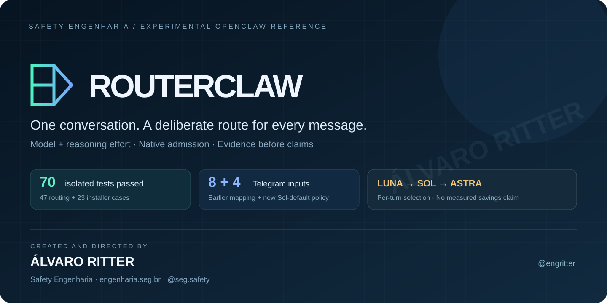
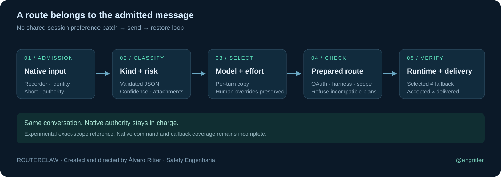

<p align="center"></p>

# RouterClaw

> **Experimental alpha — OpenClaw 2026.11.1 only. Read the installation requirements before using it.**

The new **RouterClaw experimental plugin and installer** is available as source in [packages/routerclaw](packages/routerclaw/README.md). It ships the required, exact-version host adapter, with separate preparation, explicit activation and rollback commands. It is not a universal SDK-only plugin. See the [installer scope and evidence](docs/PLUGIN-INSTALLER.md). This repository contains the source and installer. ClawHub distribution remains pending its security checks.

**Choose the model and reasoning effort for each message. Keep the conversation.**

An experimental OpenClaw integration created and directed by **Álvaro Ritter — Safety Engenharia**, with engineering assistance from AI-assisted development tools. [Português](README.pt-BR.md) · [Evidence](docs/VALIDATION.md) · [Architecture](docs/ARCHITECTURE.md) · [Authorship](AUTHORS.md)

**70 isolated tests: 47 routing cases + 23 installer cases · isolated native installation and rollback · historical real Telegram cases**

> Experimental plugin with a version-pinned host adapter, based on OpenClaw **2026.11.1 / 4ffdd20**. It includes a guarded installer for compatible Linux user services; it is not a universal plugin or an official OpenClaw feature. Historical Telegram results belong to the original deployment; a fresh installation still needs real-message validation.

## The problem

A quick question should not require the same execution choice as a critical review. Changing shared session preferences for each task also creates restoration races and confusing model reports. We wanted one continuous conversation with an execution choice tied to the admitted message, without silently erasing a human's explicit preference.

## What the prototype does

The router consumes an already-admitted native input, classifies the request, selects model and reasoning effort for that turn, and checks the prepared execution route before dispatch. It records the planned selection separately from genuine fallback. Manual model/effort preferences cause a refusal rather than being silently overwritten.

| Input in the recorded deployment | Selected model | Reasoning effort |
|---|---|---|
| Short, low-risk conversation | Luna | Low |
| Normal, low-risk request | Sol | Low |
| Review, medium risk, or attached material alone | Sol | High |
| Complex, high/unknown risk, or uncertain classification | Astra | High |

These are the author-approved roles, not a universal model-quality ranking or portable model-availability list. No automatic medium-effort tier is used. An attachment alone raises the floor to Sol/high; exceptional conditions still take precedence. The classifier itself is an additional model call. **No quota or cost saving has been measured.**



## What was actually tested

The full suite has **70 unique cases**, including the 47 routing cases below and 23 additional installer cases. It passed on Linux and Windows; repeating the suite does not increase that unique count. Native installation, startup, classifier registration and rollback were tested separately in an isolated Linux account without model calls or real Telegram bots. See [installer evidence](evidence/plugin-installer.json).

The Sol-default routing revision passed **47 isolated tests** (the prior 41 plus six policy tests), including native-function extraction fixtures, adjacent-scope preservation, input deduplication, cancellation/authority refusal, OAuth route checks and a pre-prompt recovery boundary. These are fixtures, not live authentication or billing proof.

Under the earlier role mapping, **eight real Telegram inputs** completed successfully and their replies were observed in Telegram Desktop: simple conversation, the original failing question, review plus a read-only OpenClaw tool call, conversation after that tool, a complex task, a queued follow-up, a synthetic TXT attachment, and conversation after a native status command.

The model in the execution record matched the planned model in all eight cases. Each input had one recorded classification. Four account credential/connection probes also passed; this is **not** four independent bot conversations.

See the [test matrix, boundaries and remaining gaps](docs/VALIDATION.md) and [redacted case-study metadata](evidence/telegram-case-study.json). The eight historical observations are preserved under their original mapping. See the [historical validation ledger](docs/HISTORICAL-VALIDATION.md) and [Sol-default policy revision](docs/SOL-DEFAULT.md); overlapping suites are not added into one inflated total.

## Reproduce the isolated tests

Requires Node **24.22.1+** or the compatible Node 26 LTS line, and Python 3. No API key, Telegram account, OAuth profile, dependency download, or running OpenClaw service is required.

```sh
python3 scripts/build_reference.py
node scripts/build-routerclaw.mjs
node --test test/*.test.mjs
node scripts/check-public.mjs
```

The builder verifies nine included upstream module hashes, writes only to `.generated/`, and fails on source drift. The synthetic owner and OAuth profile in the reference are fixtures, not working credentials. The generated subset is not a complete OpenClaw installation and must not replace a Gateway.

## Important limits

- Native `/status` still showed configured defaults instead of the previous response's routed model. Universal slash-command interception was **not** established by the live test; fixture success does not close that gap.
- The exact cause of the native execution-policy preparation race remains unproven. A single pre-prompt re-preparation was qualified locally; it did not need to trigger in the eight later live cases. It must never replay inference or a completed external action.
- The classifier deadline was increased from 15 to 45 seconds. Production stress coverage of that deadline is pending.
- A TXT attachment was exercised; broad image, audio and video coverage was not. Native post-terminal `invalid_content` context-snapshot warnings also remain.

See [integration and rollback boundaries](docs/INTEGRATION.md). Do not deploy from a README or treat a passing fixture as a safety or compatibility certification.

## Contributing the idea upstream

OpenClaw requests discussion before substantial architecture changes. A [previous automatic-routing request](https://github.com/openclaw/openclaw/issues/85658) was closed as community/plugin scope. We respect that decision. The [implementation follow-up](docs/UPSTREAM-COMMENT.md) shares this external reference and asks focused SDK questions; the [contract proposal](docs/UPSTREAM-PROPOSAL.md) is discussion material, not a request to merge generated distribution bundles. A portable SDK implementation and any source-level PR need agreement and focused upstream checks first.

## Credit and license

**Created and directed by Álvaro Ritter — Safety Engenharia.** Engineering assistance: AI-assisted development tools. MIT for this project's original contributions; included OpenClaw fixtures retain the upstream MIT notice. [Authors](AUTHORS.md) · [Third-party notices](THIRD_PARTY_NOTICES.md)

[Safety Engenharia](https://engenharia.seg.br/) · [Empresa @seg.safety](https://www.instagram.com/seg.safety/) · [Autor @eng.alvaroritter](https://www.instagram.com/eng.alvaroritter/)
