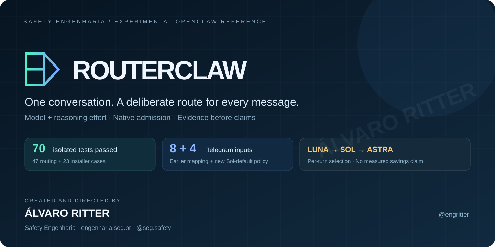
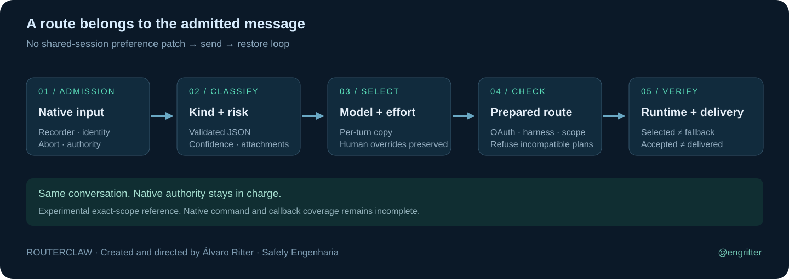

# RouterClaw

> **Versão alfa experimental — somente OpenClaw 2026.11.1. Confira os requisitos antes de instalar.**

O novo **plugin e instalador experimental RouterClaw** está disponível como código em [packages/routerclaw](packages/routerclaw/README.md), com verificação da versão, preparação separada, ativação explícita e retorno. Ele inclui a adaptação de host necessária e ainda não é um plugin universal. Veja o [escopo e as evidências do instalador](docs/PLUGIN-INSTALLER.md). Este repositório contém o código e o instalador. A versão anterior enviada ao ClawHub foi retirada para adequar a privacidade da atribuição; esta versão do código ainda não foi publicada naquele catálogo.

**Um modelo e um esforço para cada mensagem, mantendo a mesma conversa.**

Criação e direção de **Álvaro Ritter — Safety Engenharia**, com assistência de engenharia de ferramentas de desenvolvimento assistido por IA. [English](README.md) · [Autoria](AUTHORS.md) · [Validação](docs/VALIDATION.md)

O projeto nasceu de um problema real: perguntas simples, investigações e tarefas complexas recebiam a mesma configuração ou avisos de modelo difíceis de interpretar. O protótipo escolhe a execução por mensagem admitida e preserva preferências humanas explícitas, em vez de trocar a configuração compartilhada e tentar restaurá-la depois.

| Mensagem | Seleção observada |
|---|---|
| Conversa curta e de baixo risco | Luna, esforço baixo |
| Solicitação normal de baixo risco | Sol, esforço baixo |
| Revisão, risco médio ou anexo sozinho | Sol, esforço alto |
| Tarefa complexa, risco alto/desconhecido ou classificação incerta | Astra, esforço alto |

Astra fica reservado à faixa excepcional por escolha do autor. Não há faixa automática de esforço médio. Um anexo sozinho eleva a seleção a Sol/alto; risco alto e incerteza mantêm precedência. O classificador acrescenta uma chamada de IA. **Não medimos economia de franquia, custo ou desempenho.** Os nomes representam os modelos do ambiente observado; não prometem disponibilidade em outras contas.

## Evidência concreta

A suíte completa tem **70 casos únicos: 47 de roteamento e 23 do instalador**, executados em Linux e Windows. Um teste separado em uma conta Linux isolada verificou instalação, inicialização, registro do classificador e retorno à configuração anterior, sem chamadas de IA nem bots reais. Veja as [evidências do instalador](evidence/plugin-installer.json). Repetir a suíte não aumenta a contagem de casos únicos.

**47 testes isolados passaram na regra nova**: os 41 anteriores e seis específicos da política. Com a distribuição anterior, **oito mensagens reais do Telegram** tiveram execução concluída e resposta recebida: conversa simples, a pergunta que havia falhado, revisão com ferramenta de leitura, conversa depois da ferramenta, tarefa complexa, mensagem seguinte na fila, arquivo TXT sintético e conversa depois do comando de status.

Os quatro bots também passaram em sondagens individuais de conexão e credencial. Isso não equivale a testar uma conversa completa em cada bot. Os testes antigos sobrepostos não foram somados para aumentar o número anunciado. O [histórico detalhado](docs/HISTORICAL-VALIDATION.md) inclui a VPS isolada e 48 execuções comparativas com modelos explícitos; veja também a [nova política](docs/SOL-DEFAULT.md).



## O que você recebe

Código de referência, nove módulos originais do OpenClaw com licença preservada para reproduzir os testes, construtor offline com conferência de hashes, matriz de validação, metadados públicos sem dados da VPS e proposta técnica para avaliação pelo OpenClaw. A identidade visual e os créditos aparecem na capa, nos arquivos de autoria e nos cabeçalhos das contribuições originais.

Este é um **plugin experimental baseado no OpenClaw 2026.11.1**, com instalador para serviços Linux compatíveis. Confira os requisitos e use a preparação e a ativação explícitas do [manual](packages/routerclaw/README.md). Não substitua seu Gateway manualmente pelos arquivos de referência.

## Executar os testes sem tocar no servidor

Com Node 24.22.1+ ou a linha Node 26 compatível e Python 3:

```sh
python3 scripts/build_reference.py
node scripts/build-routerclaw.mjs
node --test test/*.test.mjs
node scripts/check-public.mjs
```

Não precisa de senha, token, Telegram ou conexão com modelos. Os identificadores e o perfil OAuth do código público são fictícios. A pasta gerada não contém uma instalação completa do OpenClaw.

## Limites que continuam visíveis

O comando `/status` mostra padrões da configuração, não necessariamente o modelo da última resposta. O bloqueio universal de comandos não foi comprovado no teste real. A causa exata da corrida de preparação nativa ainda não está provada; a recuperação controlada passou nos testes locais, sem precisar disparar nos oito casos reais posteriores. O novo prazo do classificador não passou por estresse real. Anexo TXT foi testado, mas áudio, vídeo e imagens não têm cobertura abrangente. Persistem avisos internos de snapshot de contexto após a finalização.

Veja [os resultados e limites](docs/VALIDATION.md), [a integração e o retorno seguro](docs/INTEGRATION.md) e [a proposta ao OpenClaw](docs/UPSTREAM-PROPOSAL.md).

**Criação e direção: Álvaro Ritter — Safety Engenharia.** Assistência de engenharia: ferramentas de desenvolvimento assistido por IA. Os direitos e créditos do código original do OpenClaw estão preservados. [Licença](LICENSE) · [Créditos](THIRD_PARTY_NOTICES.md)

[Safety Engenharia](https://engenharia.seg.br/) · [Empresa @seg.safety](https://www.instagram.com/seg.safety/) · [Autor @eng.alvaroritter](https://www.instagram.com/eng.alvaroritter/)
